# World Cup 2026 · Probabilistic Forecasting

[](https://github.com/nishchayoxford/worldcup-2026-forecasting/actions/workflows/ci.yml)


**Interpretable football models. Chronological validation. A frozen tournament holdout.**

A reproducible retrospective study of match-outcome probabilities for the men's 2026 World Cup. Elo ratings and an Elo-informed Poisson model are trained using matches before **11 June 2026**, then evaluated against the **72 group-stage results**. The emphasis is on probability quality, temporal integrity and honest uncertainty—not just picking winners.

**Author:** Nishchay Tiwari · [Methodology](docs/METHODOLOGY.md) · [Data provenance](data/README.md) · [Match-level results](artifacts/match_predictions.csv) · [Reproduce](#reproduce-the-study)

---

## Results at a glance

| | Elo + draw | Elo-informed Poisson | Historical baseline | Uniform baseline |
|---|---:|---:|---:|---:|
| **Log loss ↓** | **0.9231** | **0.8947** | 1.0835 | 1.0986 |
| **Brier score ↓** | **0.5431** | **0.5318** | 0.6546 | 0.6667 |
| Correct top picks | 44 / 72 | 44 / 72 | 33 / 72 | 34 / 72 |
| Accuracy | 61.1% | 61.1% | 45.8% | 47.2% |

Both team-strength models improve probability scores over the simple baselines on this holdout. **This is not a bookmaker comparison or a claim of profitable betting.** The two model families are reported side by side; neither is retuned on the tournament.

Brier score is summed across the three classes. Accuracy uses argmax; uniform and neutral-frequency ties select the first class, so their accuracy is not a random-guess benchmark. Full-precision results are in [`artifacts/summary.json`](artifacts/summary.json).

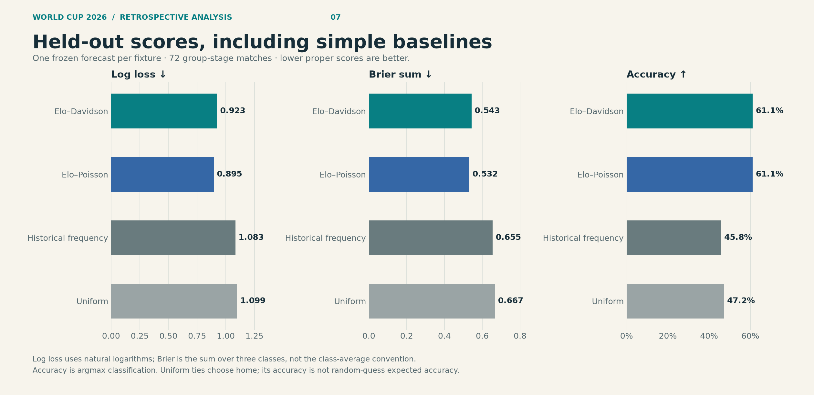

## 1 · How the study is trained and tested

**32,325 historical matches → chronological model selection → frozen probabilities → held-out evaluation.**

| Stage | Dates | Matches | Purpose |
|---|---|---:|---|
| Initial fit | 1990–2021 | 27,728 | Estimate team strength and training-only nuisance parameters |
| Validation | 2022–2023 | 2,034 | Choose hyperparameters using frozen ratings and log loss |
| Final refit | 1990–10 June 2026 | 32,325 | Refit using the selected settings and all eligible history |
| Test | World Cup 2026 group stage | 72 | Evaluate saved forecasts without tournament updates |

The final-refit window intentionally includes the earlier training and validation windows. It is not an additional disjoint partition. Tournament results are excluded from all fitting and selection.

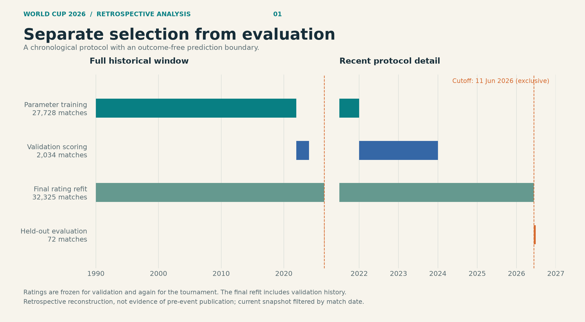

<details>
<summary><strong>Historical data coverage</strong></summary>

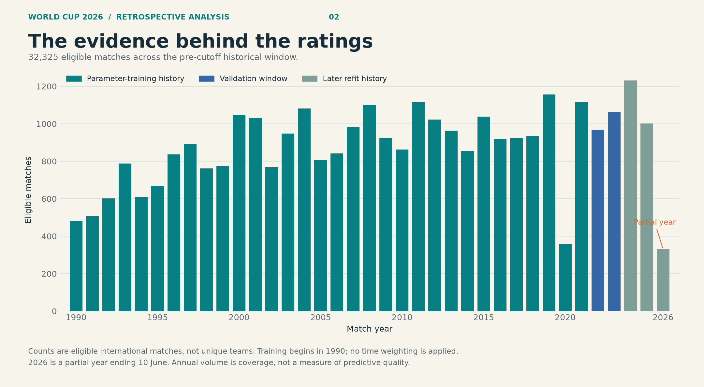

The 2026 historical bar is a partial year ending 10 June. The source includes friendlies and non-FIFA internationals, and historical scores can include extra time. See the [data dictionary](data/README.md).

</details>

### Learning team strength over time

Elo ratings update after historical results, with same-day updates applied together. The trajectories show genuine chronological rating histories, not neural-network training epochs. Teams shown are selected by their pre-tournament ratings, not by how far they progressed.

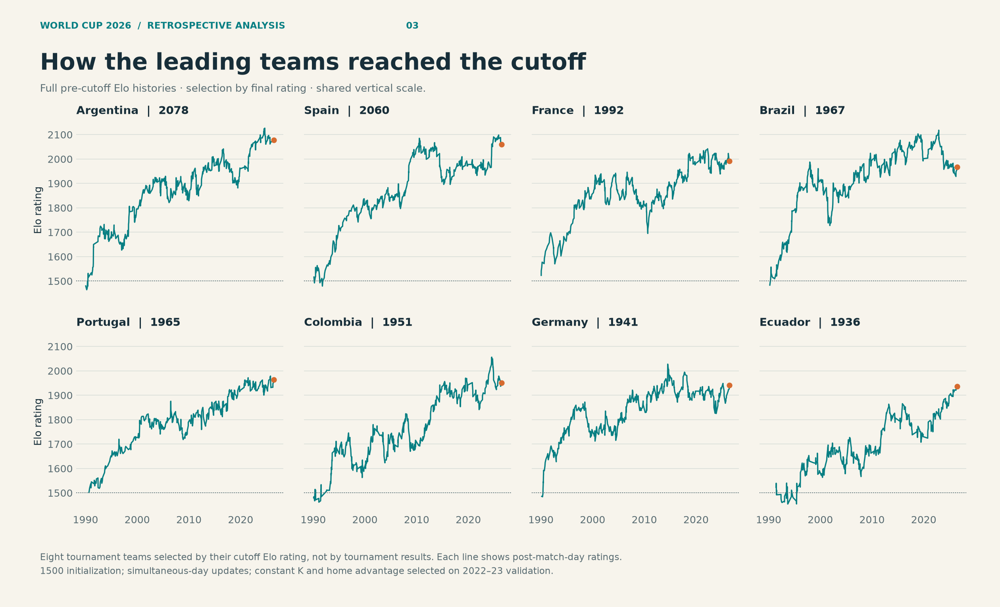

<details>
<summary><strong>Team-strength snapshot at the information cutoff</strong></summary>

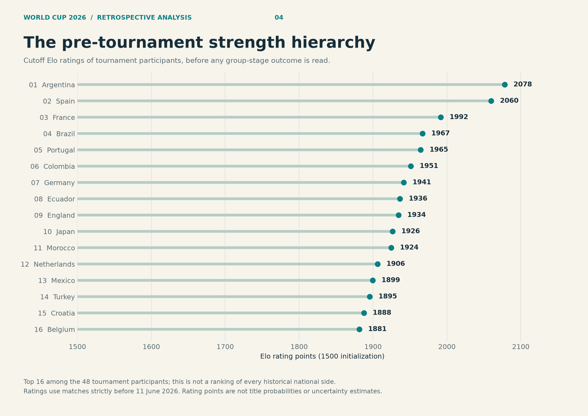

</details>

### Hyperparameters are chosen on earlier matches

Each family has a fixed 12-candidate grid. Validation selects **K = 40** and **60 Elo points of home advantage** for both families, a **0.22 equal-strength draw probability** for Elo and a **1.75 strength scale** for Poisson. Some optima sit on grid boundaries; the grid is not widened after seeing the World Cup results.

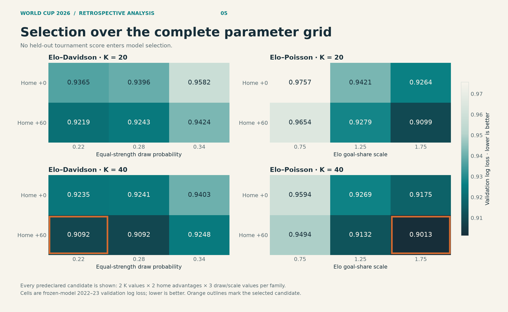

<details>
<summary><strong>How validation performance develops through time</strong></summary>

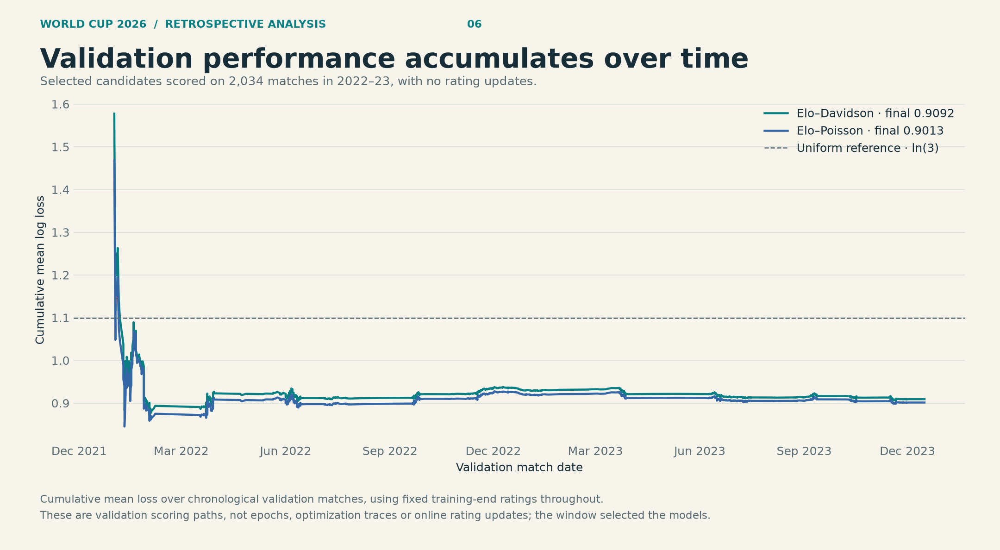

This is cumulative **validation scoring with frozen ratings**, not training loss or an epoch learning curve. The window is used for selection, so it is not a second untouched test set.

</details>

## 2 · Probability quality, not accuracy alone

### Calibration

A model can pick the right winner while assigning poor probabilities. Reliability diagrams compare predicted confidence with observed outcomes; sparse bins and intervals should be interpreted cautiously.

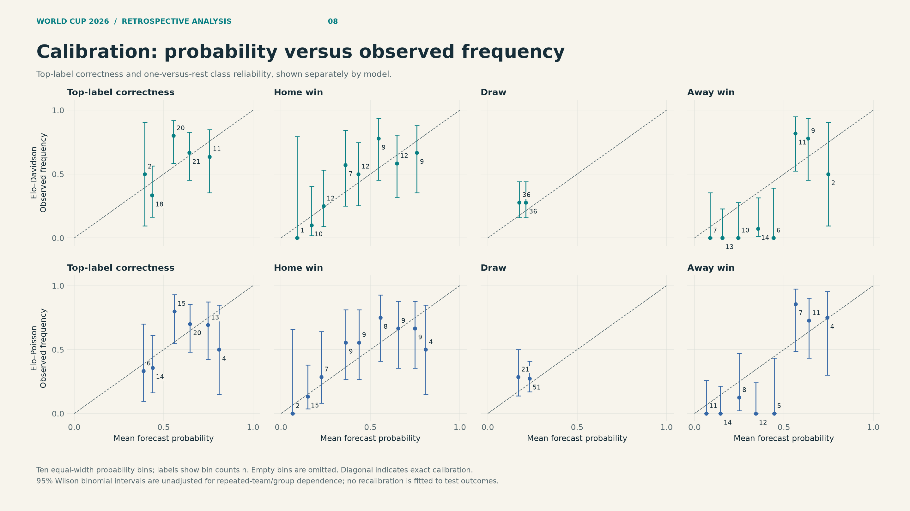

### Where the models fail

Both models allocate probability to draws, but **neither makes a draw its most likely outcome** in this run. The confusion matrices make that weakness visible rather than hiding it behind a 61.1% headline.

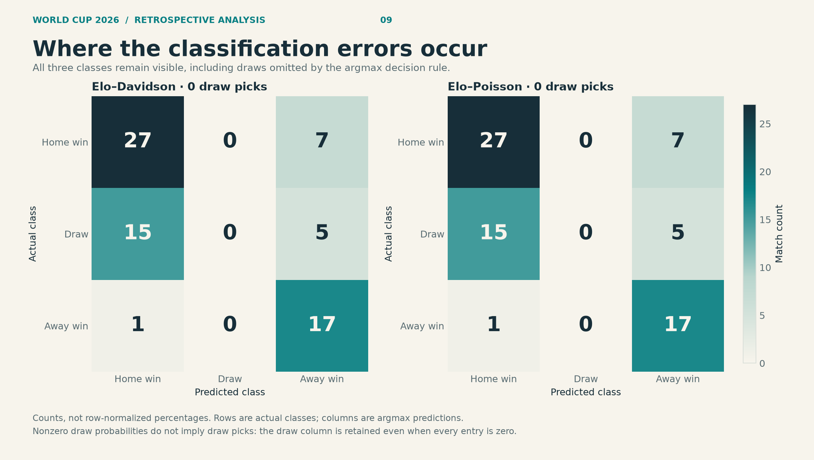

<details>
<summary><strong>Inspect the most confident errors</strong></summary>

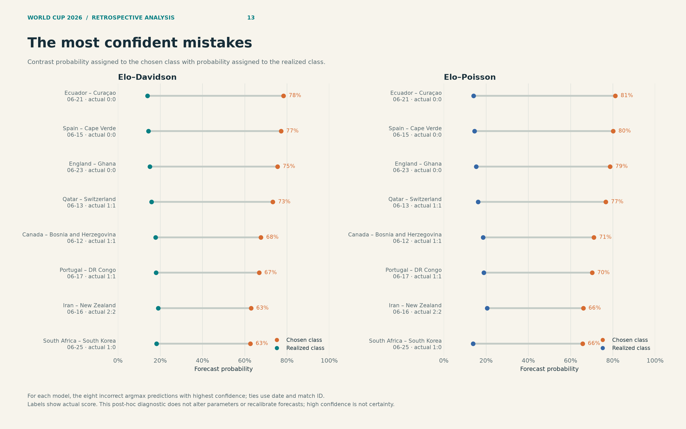

Error analysis is descriptive. It does not feed back into the fitted models or change the reported holdout scores.

</details>

### Uncertainty and dependence

The same match is paired across model and baseline when estimating the difference in log loss. Negative differences favor the model. Match-level resampling treats games as independent; group-level sensitivity checks address some within-group dependence, but only twelve groups are available. Neither approach establishes a durable market edge.

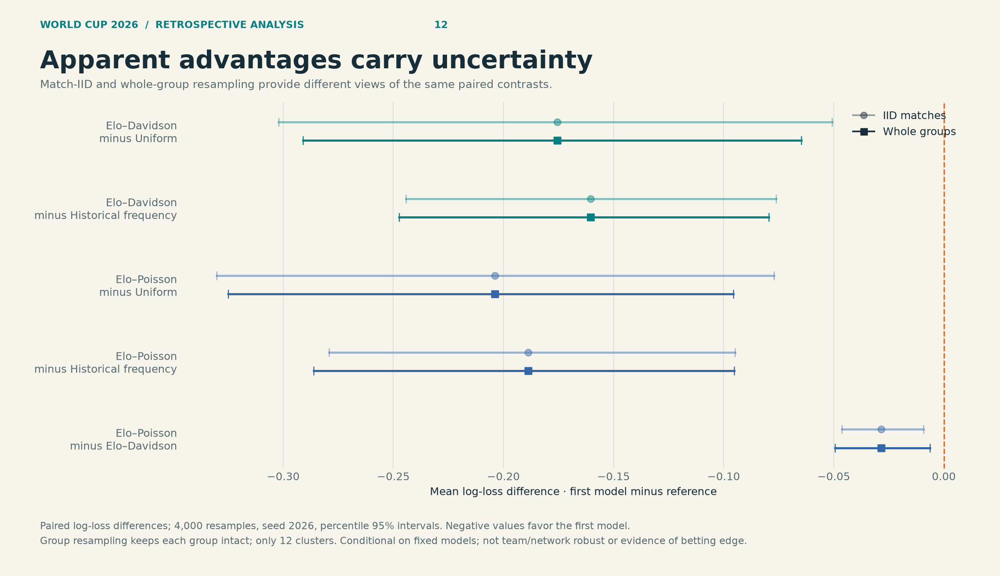

## 3 · Every forecast is inspectable

<details>
<summary><strong>All 72 match-level probability forecasts</strong></summary>

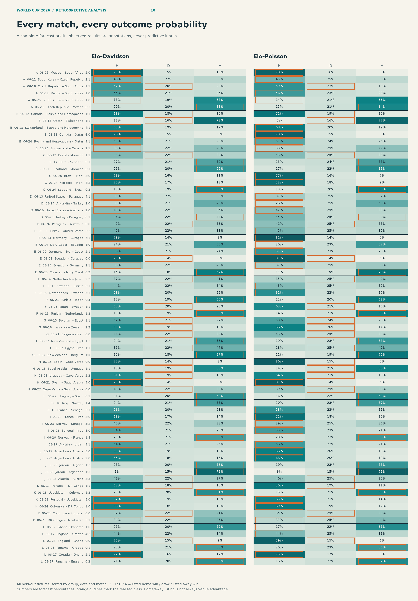

Machine-readable probabilities, actual scores and top picks are in [`artifacts/match_predictions.csv`](artifacts/match_predictions.csv). Probability order is always **home win / draw / away win**.

</details>

<details>
<summary><strong>Performance across the twelve groups</strong></summary>

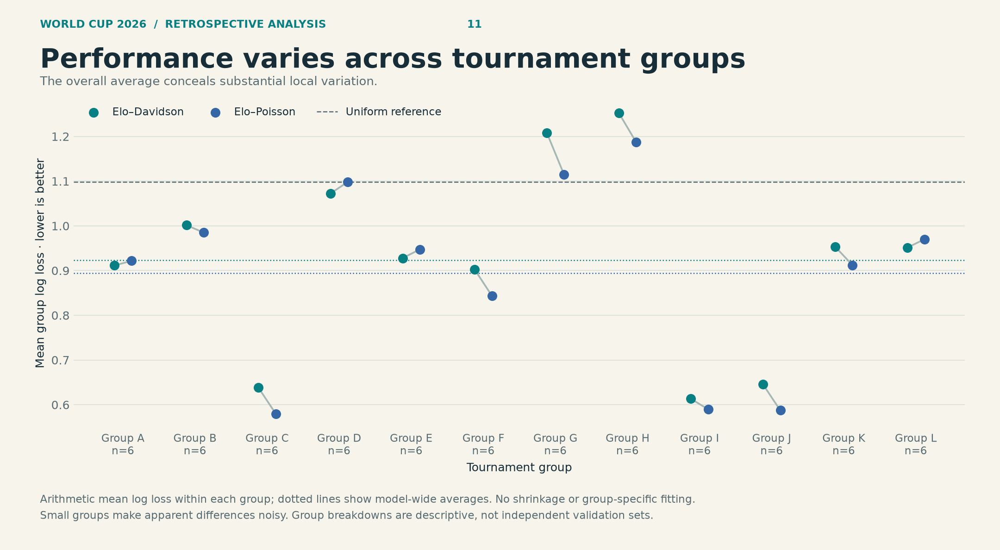

Each group has only six matches. These differences are descriptive, not a group-ranking significance test.

</details>

## Models in brief

| Model | What it does | Important assumption |
|---|---|---|
| **Elo + draw** | Converts rating differences into win/draw/loss probabilities using a Davidson-style draw term | Constant-K ratings; draw behavior controlled by one parameter |
| **Elo-informed Poisson** | Converts rating gaps to two expected goal counts and sums an independent score distribution | Independent scores and fixed total scoring intensity; not a fitted attack/defence model |
| **Historical frequencies** | Smoothed venue-conditioned outcome rates; symmetrized at neutral venues | No team-specific strength |
| **Uniform** | Assigns one-third to each outcome | No information |

The full equations, selection protocol, numerical conventions and limitations are documented in the [methodology and model card](docs/METHODOLOGY.md).

## Reproduce the study

The repository includes versioned inputs and a dependency lockfile. **No API key, scraping step or live data service is needed.**

```bash
git clone https://github.com/nishchayoxford/worldcup-2026-forecasting.git
cd worldcup-2026-forecasting
uv sync --locked --python 3.11
uv run python run_pipeline.py --plots
```

Verify the implementation and reproduce the committed results without overwriting them:

```bash
uv run pytest -q
uv run ruff check .
uv run python run_pipeline.py --check
```

The core forecasting engine uses Python's standard library. NumPy and Matplotlib support the diagnostic figures. If not using `uv`, install the project dependencies listed in [`pyproject.toml`](pyproject.toml) into a Python 3.11+ environment.

### Separate prediction from evaluation

```bash
uv run python model.py predict \
  --history data/history.csv \
  --fixtures data/fixtures.csv \
  --output artifacts/predictions.json

uv run python model.py evaluate \
  --predictions artifacts/predictions.json \
  --outcomes data/outcomes.csv \
  --output artifacts/evaluation.json
```

The prediction command has no outcome-file argument. Tests cover cutoff enforcement, outcome independence, same-input reproducibility, invalid data, exact target joins and probability/metric correctness. CI runs on Linux and Windows and verifies the committed forecast probabilities and scores.

## Repository map

```text
model.py                  # Elo, Poisson, selection, prediction and evaluation
validate_data.py          # Hash, schema, temporal and round-robin checks
run_pipeline.py           # Reproduce results or check the committed artifacts
analysis.py               # Rating, validation, calibration and uncertainty diagnostics
plots.py                  # Rebuild the publication figures
test_*.py                 # Unit and integration tests
data/                     # Versioned inputs, provenance and CC0 license
artifacts/                # Full predictions, scores and diagnostic data
docs/
   METHODOLOGY.md          # Equations, design decisions and model limitations
   figures/               # README figures, PNG and vector SVG
.github/workflows/ci.yml   # Automated quality and reproducibility checks
```

## Scope and limitations

- **Retrospective design:** the historical snapshot is filtered by match date, not an archived pre-tournament data vintage. Actual execution timestamps are retained; this repository does not claim contemporaneously published forecasts.
- **One tournament:** 72 matches do not establish broad generalization, and shared teams create dependence.
- **Label consistency:** historical extra-time scores differ from the regulation-time group-stage target.
- **No betting claim:** no bookmaker odds, transaction costs, stakes or trading returns are modelled.
- **Group stage only:** a pre-tournament knockout analysis must simulate unknown pairings rather than use the realized bracket.

Natural next steps are regulation-time historical labels, multi-tournament rolling holdouts, a fitted attack/defence model, explicitly time-weighted ratings and a separately designed comparison against timestamped market probabilities.

## Attribution and licensing

Code: [MIT](LICENSE). Historical match data and target goals: [martj42/international_results](https://github.com/martj42/international_results), [CC0 1.0](data/LICENSE-CC0.txt). Minimal fixture annotations and source distinctions are documented in [data/README.md](data/README.md). Figures are generated from the versioned research data; no official logos or promotional imagery are used. This project is not affiliated with FIFA or a betting operator.
